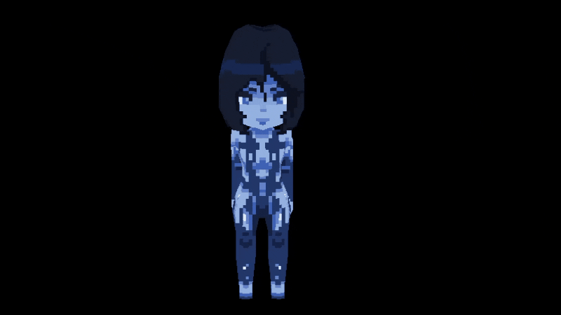

# Cortana Project

A Raspberry Pi 5–based AI assistant with a custom animated touchscreen interface inspired by Cortana from *Halo*.

The project combines an OpenAI-powered assistant, live weather information, animated Pygame states, and fullscreen web applications into a dedicated 7-inch touchscreen device.

> This is a personal fan project and is not affiliated with Microsoft, Xbox, or 343 Industries.

---

## Demo

<p align="center">
  
</p>

---

## Features

- Custom animated Cortana-inspired interface built with Pygame
- Raspberry Pi 5 with an 800×480 capacitive touchscreen
- OpenAI integration for general conversation and questions
- Live weather data through OpenWeatherMap
- Weather visualization integrated directly into the UI
- Fullscreen Chromium application switching
- YouTube touchscreen interface
- Gemini touchscreen interface
- Separate UI and assistant processes
- UDP communication between the main assistant and animation system
- Multiple animation states for different assistant actions

---

## Hardware

| Component | Purpose |
| --- | --- |
| Raspberry Pi 5 8GB | Main computer |
| 7-inch 800×480 DSI touchscreen | User interface |
| Active cooling | Pi 5 cooling |
| Power supply | System power |

---

## How It Works

The project separates the assistant logic from the graphical interface.

```text
                         ┌─────────────────┐
                         │      User       │
                         └────────┬────────┘
                                  │
                                  ▼
                         ┌─────────────────┐
                         │  Main Assistant │
                         │ Command Routing │
                         └────┬─────┬──────┘
                              │     │
                 ┌────────────┘     └────────────┐
                 ▼                               ▼
        ┌────────────────┐              ┌────────────────┐
        │   OpenAI API   │              │ OpenWeatherMap │
        └────────────────┘              └────────────────┘

                         │
                         │ UDP
                         ▼

                ┌─────────────────────┐
                │      Pygame UI      │
                │ Animation / Weather │
                └─────────────────────┘

                         +

                ┌─────────────────────┐
                │      Chromium       │
                ├─────────────────────┤
                │ YouTube             │
                │ Gemini              │
                └─────────────────────┘
```

The main Python process handles commands, API requests, and application control. The Pygame interface runs separately so animations can continue independently of assistant operations.

Small UDP messages are used to tell the display which animation or information to show.

## Weather Interface

Weather information is retrieved from OpenWeatherMap and sent to the display process.

The UI can display:

- Current temperature
- Daily high and low
- Weather condition
- Humidity
- Wind speed
- Current location

Weather information is rendered directly beside the character using a minimal turquoise-on-black interface designed for the 800×480 display.

---

## Web Applications

The assistant can switch from the Pygame interface to fullscreen Chromium applications.

### YouTube

Opens the standard YouTube website fullscreen so the touchscreen can be used normally for browsing, searching, and playback.

### Gemini

Opens Gemini fullscreen for a traditional text-based AI interface.

Closing Chromium returns the user to the still-running Pygame interface.

---

## Software

- Python 3.12
- Pygame
- OpenAI Python API
- Requests
- Geocoder
- Chromium
- Raspberry Pi OS

---

## Python Dependencies

Install the required Python packages:

```bash
pip install pygame openai requests geocoder
```

Or, if a `requirements.txt` file is included:

```bash
pip install -r requirements.txt
```

---

## API Configuration

The project expects API keys to be stored as environment variables rather than committed to the repository.

### OpenAI

```bash
export OPENAI_API_KEY="your_key_here"
```

### OpenWeatherMap

```bash
export current_weather_data="your_key_here"
```

---

## Current Architecture

The project currently uses several animation/action states, including:

```text
idle
weather
cross
crossstill
uncross
dismiss
still
```

Commands are sent from the assistant process to the animation process, allowing the character to react to what the assistant is doing.


## Why I Built It

I wanted to build an AI assistant as a dedicated physical device rather than another chatbot running inside a browser.

The project combines embedded hardware, Python, APIs, process communication, UI design, animation, and AI into a single system built around the Raspberry Pi 5.

The long-term goal is to continue developing it into a responsive always-available assistant with its own interface, personality, and system integrations. Eventually with its own battery and plug and go to take anywhere with offline functionality.
